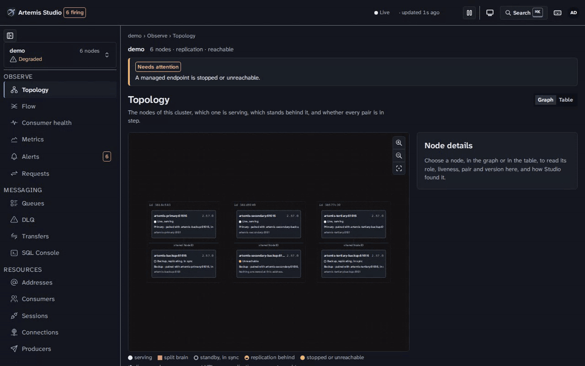
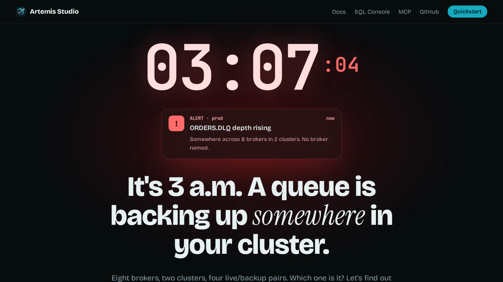
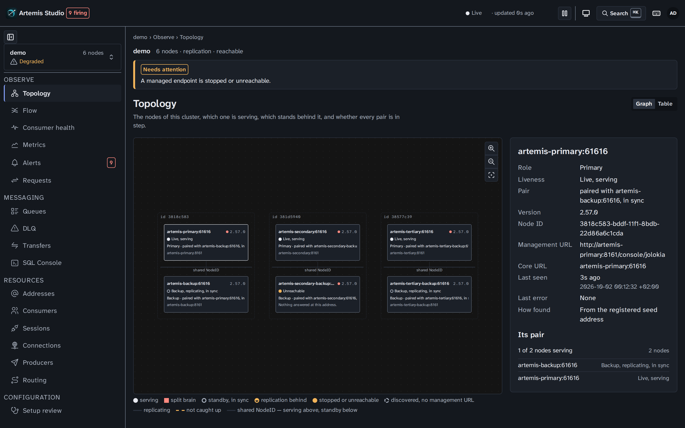
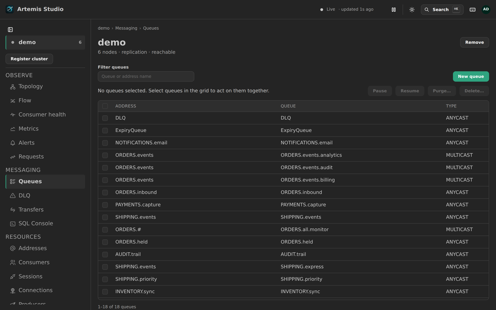
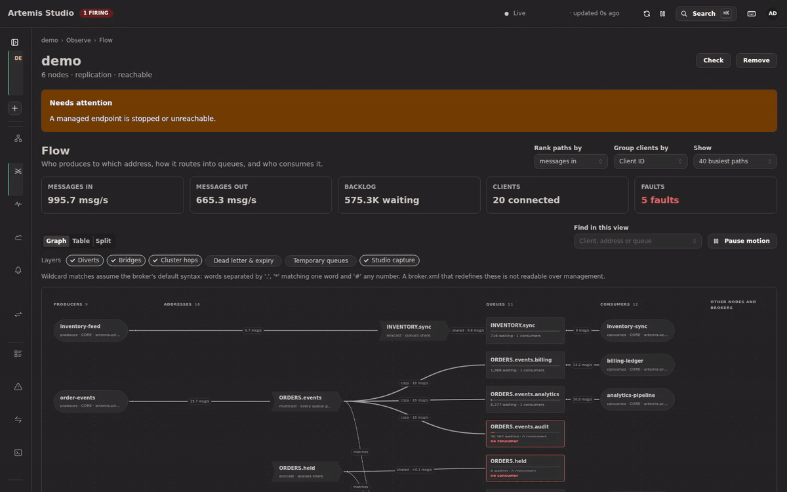
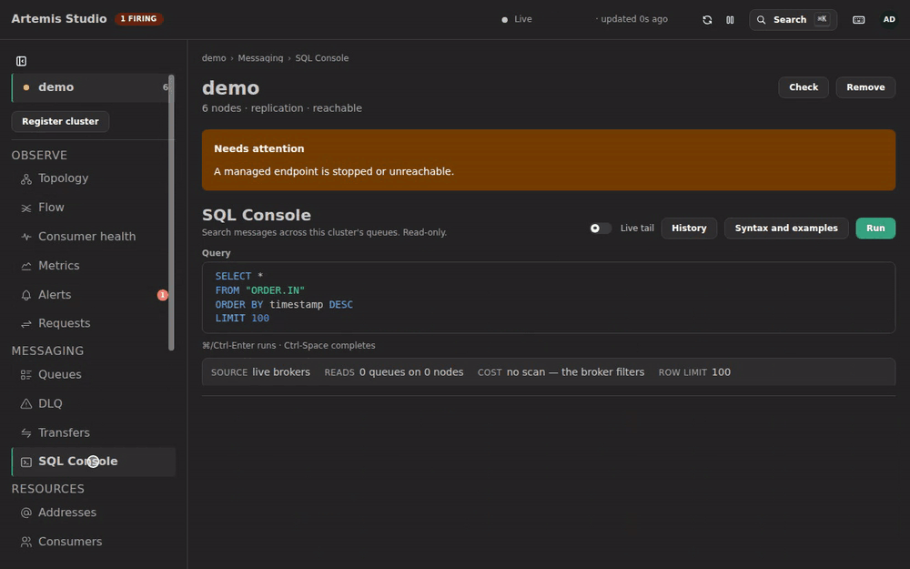
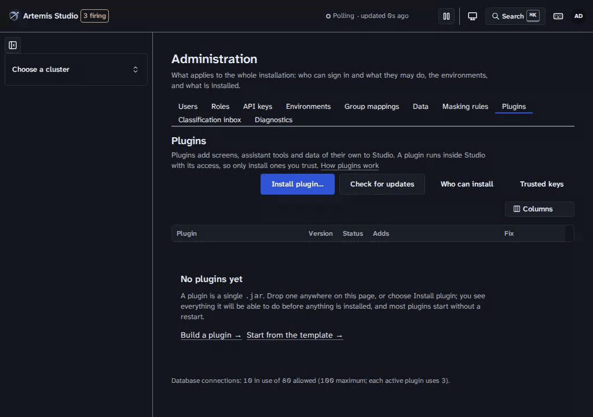
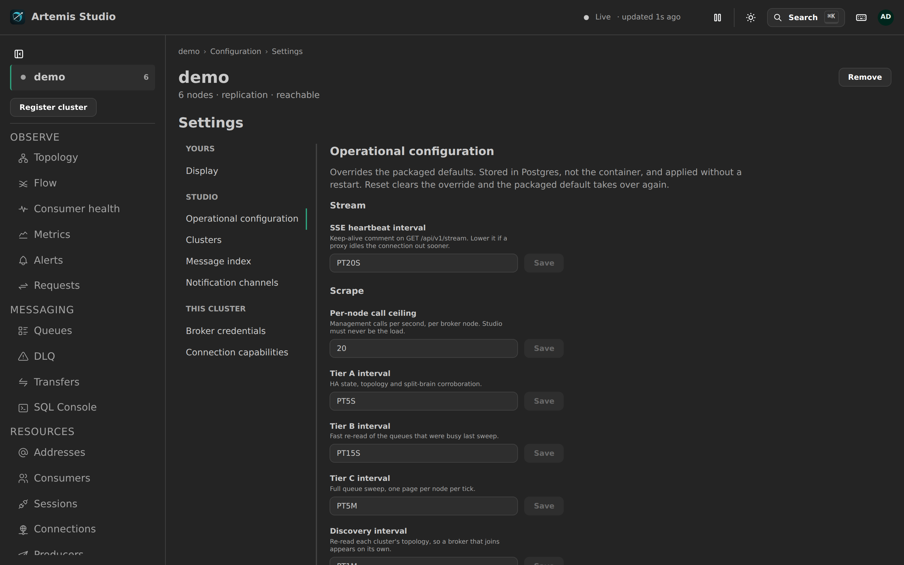

<div align="center">


# Rahdar

<sub>«راهدار» از «راه» + «دار» (نگه‌دارنده) ساخته شده است: نگهبانی که همهٔ راه‌هایی را که پیام‌هایتان می‌پیمایند باز و امن نگه می‌دارد.</sub>

**یک کنسول برای همهٔ کلاسترهای Apache ActiveMQ Artemis که دارید.**

توپولوژی زنده، همهٔ صف‌های همهٔ نودها در یک جدول، مسیر پیام‌ها جلوی چشمتان، عملیات امن روی پیام‌ها و جست‌وجوی پیام‌ها با SQL؛ همه از یک نمونهٔ Rahdar.

<a href="https://rahdar.dev/fa/"></a><br>
<sub>یک رخداد تعاملی ساعت سه بامداد · حدود ۲ دقیقه · در مرورگر خودتان اجرا می‌شود</sub>

[English](README.md) · [简体中文](README.zh.md) · **فارسی**

[](https://github.com/sudoitir/rahdar/actions/workflows/ci.yml)
[](https://github.com/sudoitir/rahdar/releases)
[](https://hub.docker.com/r/sudoit1/rahdar)
[](https://scorecard.dev/viewer/?uri=github.com/sudoitir/rahdar)
[](https://sonarcloud.io/summary/new_code?id=sudoitir_rahdar)
[](https://sonarcloud.io/summary/new_code?id=sudoitir_rahdar)
[](https://sonarcloud.io/summary/new_code?id=sudoitir_rahdar)
[](https://sonarcloud.io/summary/new_code?id=sudoitir_rahdar)
[](https://sonarcloud.io/summary/new_code?id=sudoitir_rahdar)
[](LICENSE)

[مستندات](https://rahdar.dev/fa/guide/) ·
[شروع سریع](#شروع-سریع) ·
[Flow](https://rahdar.dev/guide/flow) ·
[SQL Console](https://rahdar.dev/fa/guide/sql-console) ·
[MCP](https://rahdar.dev/fa/guide/mcp) ·
[گفت‌وگوها](https://github.com/sudoitir/rahdar/discussions)

</div>

> [!WARNING]
> **نسخهٔ آلفا.** پروژه در حال توسعهٔ فعال است و هنوز همهٔ قابلیت‌هایش را ندارد. ایمیج‌های منتشرشده، بیلدهای dev پیش از نسخهٔ پایدارند (`sudoit1/rahdar:dev`؛ هنوز `:latest` نداریم). منتظر تغییرات ناسازگار باشید.



<div dir="rtl" align="right">

## شروع سریع

Rahdar و Postgres آن، از روی ایمیج منتشرشده. بروکرهایتان همان‌طور که هستند می‌مانند: آن‌ها را در رابط کاربری ثبت می‌کنید و هیچ‌کدام از این دستورها بروکری راه نمی‌اندازد.

</div>

```bash
base=https://raw.githubusercontent.com/sudoitir/rahdar/main/deploy/compose
mkdir -p rahdar/compose rahdar/postgres && cd rahdar/compose   # the compose file mounts ../postgres
curl -sO "$base/compose.prod.yaml"
for f in postgresql.conf 10-pg-stat-statements.sql; do curl -s "${base%/compose}/postgres/$f" -o "../postgres/$f"; done
curl -s "$base/.env.example" | sed \
  -e "s|^SECRET_KEY=.*|SECRET_KEY=$(openssl rand -base64 32)|" \
  -e "s|^DB_PASSWORD=.*|DB_PASSWORD=$(openssl rand -hex 24)|" > .env
docker compose -f compose.prod.yaml --env-file .env up -d
docker compose -f compose.prod.yaml logs rahdar | grep -A4 'Created administrator'
```

<div dir="rtl" align="right">

سپس <http://localhost:8080> را باز کنید و با کاربر `admin` و رمزی که خط آخر چاپ می‌کند وارد شوید. این رمز فقط یک بار نشان داده می‌شود و در اولین ورود، رمز دلخواه خودتان را انتخاب و تأیید دومرحله‌ای‌ای را که نقش admin می‌خواهد راه‌اندازی می‌کنید.

</div>

<details>
<summary dir="rtl">از روی کلون مخزن با <code>just</code>، یا یک کانتینر تنها روی Postgres خودتان</summary>

```bash
git clone https://github.com/sudoitir/rahdar && cd rahdar
just up          # دو replica پشت HAProxy، قفل‌شده روی آخرین نسخه (just up-single: یک replica)
```

```bash
docker run -p 8080:8080 \
  -e RAHDAR_DB_URL=jdbc:postgresql://db:5432/rahdar \
  -e RAHDAR_DB_USER=rahdar \
  -e RAHDAR_DB_PASSWORD=... \
  -e RAHDAR_SECRET_KEY="$(openssl rand -base64 32)" \
  sudoit1/rahdar:dev
```

</details>

<div dir="rtl" align="right">

همهٔ متغیرها، تنظیمی که reverse proxy برای جریان SSE لازم دارد و راه بازیابی اولین ورودِ ازدست‌رفته در [راهنمای پیکربندی](https://rahdar.dev/fa/guide/configuration) آمده است.

## چرا

ساعت سه بامداد است و `ORDERS.DLQ` جایی در کلاستر شما دارد پر می‌شود. کنسولی که همراه Artemis می‌آید هر بار فقط یک بروکر را مدیریت می‌کند و اصلاً از وجود کلاستر خبر ندارد؛ پس برای هر نود یک تب باز می‌کنید، در هر کدام درخت JMX را زیر و رو می‌کنید و attributeها را یکی‌یکی می‌خوانید تا بالاخره پیدایش کنید.

Rahdar **کلاستر را واحد همه‌چیز** می‌داند. همهٔ نودهای همهٔ کلاسترها روی یک توپولوژی‌اند و نقش HA هرکدام زنده poll می‌شود. همهٔ صف‌های همهٔ نودها هم در یک جدول‌اند، مرتب‌شده بر اساس عمق صف؛ پس صفی که دنبالش بودید ردیف اول است. یک نمونهٔ Rahdar برای هر تعداد کلاستری که دارید کافی است و روی همان بروکرهای فعلی‌تان کار می‌کند.

<a href="https://rahdar.dev/fa/"></a>

**[▶ داستان را بازی کنید](https://rahdar.dev/fa/)**: اول خودتان با یک تب برای هر بروکر دنبال صف بگردید، بعد ببینید Rahdar چطور آن را در یک صفحه پیدا می‌کند.

## چه کارهایی می‌کند

</div>

| توپولوژی کلاستر | صف‌های همهٔ نودها |
|---|---|
| [](docs/img/topology.png) | [](docs/img/queues.png) |
| **کلاینت‌ها و مسیر پیام** | **SQL Console** |
| [](docs/img/flow.gif) | [](docs/img/sql-console.gif) |
| **پلاگین‌ها** | **تنظیمات** |
| [](docs/img/plugin-install.gif) | [](docs/img/settings.png) |

<div dir="rtl" align="right">

- **توپولوژی**: جفت‌های live/backup و وضعیت replication آن‌ها. نقش HA در هر چرخه از تک‌تک نودها poll می‌شود و هرگز از پیکربندی خوانده نمی‌شود؛ اگر در یک جفت دو نود هم‌زمان live باشند، هشدار split-brain داده می‌شود.
- **[Flow](https://rahdar.dev/guide/flow)**: کدام اپلیکیشن به کدام آدرس پیام می‌فرستد، آن آدرس از مسیر divertها، bridgeها و پرش‌های کلاستر به کدام صف‌ها می‌رسد، و چه کسی با چه نرخی آن‌ها را مصرف می‌کند. مشکلاتی مثل انباشت پیام بدون مصرف‌کننده با کلمات روشن گفته می‌شوند، و از کلاینت‌ها فقط تا وقتی کسی صفحه را نگاه می‌کند نمونه‌برداری می‌شود.
- **[SQL Console](https://rahdar.dev/fa/guide/sql-console)**: Artemis نمی‌تواند بگوید *سفارش ۴۴۷۱ کجا رفت*. تنها فیلتر سمت سرورش JMS selector است: فقط هدرها را می‌بیند و هیچ‌وقت بدنهٔ پیام را نه، آن هم هر بار فقط یک صف روی یک نود. Rahdar از پسش برمی‌آید:

</div>

```sql
SELECT * FROM "ORDER.*"
WHERE body->>'orderId' = '4471'
LIMIT 50
```

<div dir="rtl" align="right">

زبان کوئری فقط `SELECT` فقط‌خواندنی است و با فهرست ثابتی از ستون‌ها سنجیده می‌شود، پس هیچ کوئری‌ای نمی‌تواند چیزی را تغییر دهد. شرط‌های روی هدر به JMS selector تبدیل می‌شوند و هزینه‌ای ندارند؛ شرط‌های روی بدنه نیاز به پیمایش دارند، و **نوار plan پیش از اجرای کوئری می‌گوید کدام حالت است**. کوئری‌ای که از سقف هزینه بگذرد همراه با برآوردش رد می‌شود، نه اینکه بی‌صدا نتیجه‌اش بریده شود. می‌توانید tail زنده اضافه کنید یا برای یک صف [capture کامل](https://rahdar.dev/fa/guide/message-capture) را روشن کنید: یک کپی با ظرفیت محدود روی خود بروکر که Rahdar آن را تخلیه می‌کند، تا حتی پیامی که بین دو poll مصرف شده هم قابل پیدا کردن باشد.

- **منابع همهٔ نودها**: صف‌ها، آدرس‌ها، مصرف‌کننده‌ها، نشست‌ها، اتصال‌ها و تولیدکننده‌ها در یک جدول مجازی؛ هر ردیف نشان می‌دهد مال کدام نود است و از طریق SSE به‌روز می‌ماند.
- **عملیات روی پیام**: مرور، ارسال، جابه‌جایی، retry، منقضی‌کردن، حذف و purge. هر فراخوانی تغییردهنده `?dryRun=true` را می‌پذیرد، عملیات گروهی در سمت سرور سقف دارند و نتیجه به تفکیک نود گزارش می‌شود.
- **ردیابی request-reply**: درخواست‌ها در همهٔ آدرس‌ها و نودها به پاسخ‌هایشان وصل می‌شوند و آمار تأخیر و timeout با انتظاراتی که تعریف کرده‌اید سنجیده می‌شود.
- **[پیکربندی بروکر](https://rahdar.dev/fa/guide/broker-configuration)**: address settingها، security settingها، divertها، bridgeها و صف‌هایی را که کلاستر باید داشته باشد تعریف کنید و مسیریابی بینشان را روی یک بوم بچینید. آن‌ها را اول روی یک نود قناری اعمال کنید، در حالی که پیش از هر نوشتنی همهٔ خطرها گفته می‌شود، یا به‌صورت بخشی از `broker.xml` خروجی بگیرید و ببینید هر نود کجا از تعریف فاصله گرفته است. در اولین اجرا، Rahdar وضعیت فعلی کلاستر را به‌عنوان نسخهٔ ۱ پیشنهاد می‌دهد؛ بی‌اجازهٔ شما چیزی پذیرفته نمی‌شود، و هیچ bridgeای هرگز پذیرفته نمی‌شود، چون بروکر فقط بخشی از آن را گزارش می‌کند.
- **[بازبینی راه‌اندازی](https://rahdar.dev/guide/setup-review)**: پیکربندی HA، کلاسترینگ، ماندگاری و ایمنی پیام در هر کلاستر با اشتباه‌های شناخته‌شده سنجیده می‌شود: یک جفت replication تنها که نمی‌تواند در رأی‌گیری quorum برنده شود، redistribution که روی `-1` مانده، connectorی که `localhost` را اعلام می‌کند، نبودِ آدرس dead-letter. هر یافته شواهدش را به تفکیک نود و اصلاحیهٔ `broker.xml` را همراه دارد، و می‌توان آن را با ذکر دلیل و به‌صورت ثبت‌شده، به‌عنوان ریسکی شناخته‌شده پذیرفت.
- **[ارسال هشدار](https://rahdar.dev/guide/alert-delivery)**: Slack، Microsoft Teams، PagerDuty (incidentها همراه با هشدار باز و بسته می‌شوند)، ایمیل و webhookهای امضاشده؛ هرکدام پیش از ذخیره آزمایش می‌شود و گزارش ارسال می‌گوید چرا یک اعلان نرسیده است.
- **[حاکمیت داده](https://rahdar.dev/guide/data-governance)**: هدرها و propertyهای حساس پوشانده می‌شوند، اطلاعات شخصی (PII) خودکار دسته‌بندی می‌شود و پوشاندنشان به نقش بیننده بستگی دارد.
- **حاکمیت**: احراز هویت در همه‌جا، نقش‌ها و مجوزها در سه سطح سراسری ← محیط ← کلاستر، توکن‌های API، OIDC/SSO اختیاری، و گزارش ممیزی‌ای که هر تغییر و نتیجه‌اش را ثبت می‌کند.
- **[سرور MCP](https://rahdar.dev/fa/guide/mcp)**: همین قابلیت‌ها برای دستیار هوش مصنوعی، با همان مجوزها و همان گزارش ممیزی.
- **[پلاگین‌ها](https://rahdar.dev/guide/plugins)**: فایل `.jar` یک پلاگین را از رابط کاربری نصب کنید؛ با صفحه‌ها، API، ابزارهای دستیار و داده‌های مخصوص خودش. پیش از تأیید، هر کاری که می‌تواند بکند نشان داده می‌شود و جز در صورت نیاز، راه‌اندازی مجدد لازم نیست. به‌روزرسانی‌ها نشان می‌دهند چه چیزی عوض می‌شود و قابل بازگشت‌اند؛ پلاگینی که خطا بدهد هرگز Rahdar را از کار نمی‌اندازد. برای شروع یک پلاگین از [قالب آماده](examples/plugin-template) استفاده کنید.

## چطور کار می‌کند

چهار قاعده در سراسر محصول برقرار است:

- **از پایه، هوای بروکر را دارد.** خواندن‌ها دسته‌ای است (برای هر نود یک POST به Jolokia، هرگز یکی برای هر صف)، polling لایه‌بندی شده و برای هر نود محدودیت نرخ وجود دارد. Rahdar هرگز نباید دلیل از پا افتادن یک بروکر باشد.
- **پیش‌فرض، ایمنی است.** هر فراخوانی مخرب را می‌شود اول به‌صورت dry run اجرا کرد، و برای purge و حذف باید نام منبع را تایپ کنید.
- **وضعیت HA از نودها می‌آید، نه از پیکربندی.** اینکه چه کسی live است را فقط نودهای live می‌دانند.
- **صداقت دربارهٔ قابلیت‌ها.** اگر قابلیتی در دسترس نباشد، همین را می‌گوید و دقیقاً همان `broker.xml` لازم برای فعال‌کردنش را نشان می‌دهد. هیچ‌چیز بی‌صدا ناپدید نمی‌شود.

Java 25 · Spring Boot 4.1 · PostgreSQL با Liquibase · React 19 + Vite + Mantine 9 · TanStack Router/Query/Table · React Flow · در درجهٔ اول Jolokia روی HTTP و در درجهٔ دوم کلاینت Core خود Artemis · SSE · یک ایمیج کانتینر. [معماری](https://rahdar.dev/reference/architecture) و [همهٔ تصمیم‌های ثبت‌شده](https://rahdar.dev/reference/adr/) را بخوانید.

## مشارکت

پرسش‌ها و ایده‌ها را در [Discussions](https://github.com/sudoitir/rahdar/discussions)، باگ‌ها را در [issues](https://github.com/sudoitir/rahdar/issues/new/choose) و آسیب‌پذیری‌ها را از طریق [گزارش خصوصی](https://github.com/sudoitir/rahdar/security/advisories/new) ([SECURITY.md](SECURITY.md)) مطرح کنید. برای بیلد به JDK 25، Node 24، Docker و [`just`](https://github.com/casey/just#packages) نیاز دارید؛ یک dev container هم آماده است.

</div>

```bash
just dev-up          # Postgres + یک جفت واقعی primary/backup از Artemis + Rahdar، از روی سورس
just dev             # یا: بک‌اند :8080 و Vite :5173 با هم، همراه با live reload
just verify          # همهٔ بررسی‌های CI
```

<div dir="rtl" align="right">

فرمان `ADMIN_PASSWORD=… just demo` (اجرای اول به `NEW_ADMIN_PASSWORD=…` و اجراهای بعدی به `ADMIN_TOTP_SECRET=…` هم نیاز دارند) دو جفت live/backup دیگر اضافه می‌کند و هر شش نود را با ترافیکی شبیه محیط واقعی پر می‌کند: divertها، یک bridge، پرش‌های کلاستر، صفی بدون مصرف‌کننده که مدام پرتر می‌شود، انباشت واقعی dead-letter و یک نود متوقف. تصاویر بالا با `just shots` و `just demo-gif` از همین استک ضبط شده‌اند و هیچ‌چیزشان صحنه‌سازی نیست.

هر قابلیت از فرایند **OpenSpec** می‌گذرد و تصمیم‌های مهم به‌صورت [**ADR**](docs/adr/) ثبت می‌شوند. از [`CONTRIBUTING.md`](CONTRIBUTING.md) شروع کنید.

## انتشار نسخه‌ها

هر merge که اپلیکیشن را تغییر دهد یک نسخهٔ جدید منتشر می‌کند. شمارهٔ نسخه به شکل CalVer (`YYYY.MM.PATCH`) است و روی Docker Hub سه تگ می‌گیرد: `2026.09.3` (تغییرناپذیر)، `2026.09` (همان ماه) و `dev` (آخرین نسخه). تا اولین نسخهٔ پایدار، تگ `:latest` نداریم. فایل jar قابل‌اجرا همراه `.sha256` به هر نسخه پیوست می‌شود و یادداشت‌های انتشار از پیام‌های commit ساخته می‌شوند ([GitHub Releases](https://github.com/sudoitir/rahdar/releases)). API پلاگین (Maven Central) و SDK (npm) همراه نسخه‌هایی منتشر می‌شوند که تغییرشان می‌دهند.

## مجوز

[Apache-2.0](LICENSE)؛ همان مجوزی که خود Artemis دارد.

Apache ActiveMQ و Apache ActiveMQ Artemis علامت‌های تجاری بنیاد نرم‌افزار Apache هستند. Rahdar پروژه‌ای مستقل است؛ نه ساختهٔ بنیاد نرم‌افزار Apache است، نه مورد تأیید آن و نه وابسته به آن. هر جا از «Artemis» نام برده شده، منظور بروکری است که این ابزار مدیریتش می‌کند.

</div>

---

<div align="center">

اگر در وقتتان صرفه‌جویی کرد، با یک ⭐ به دیده‌شدنش کمک کنید.

</div>
